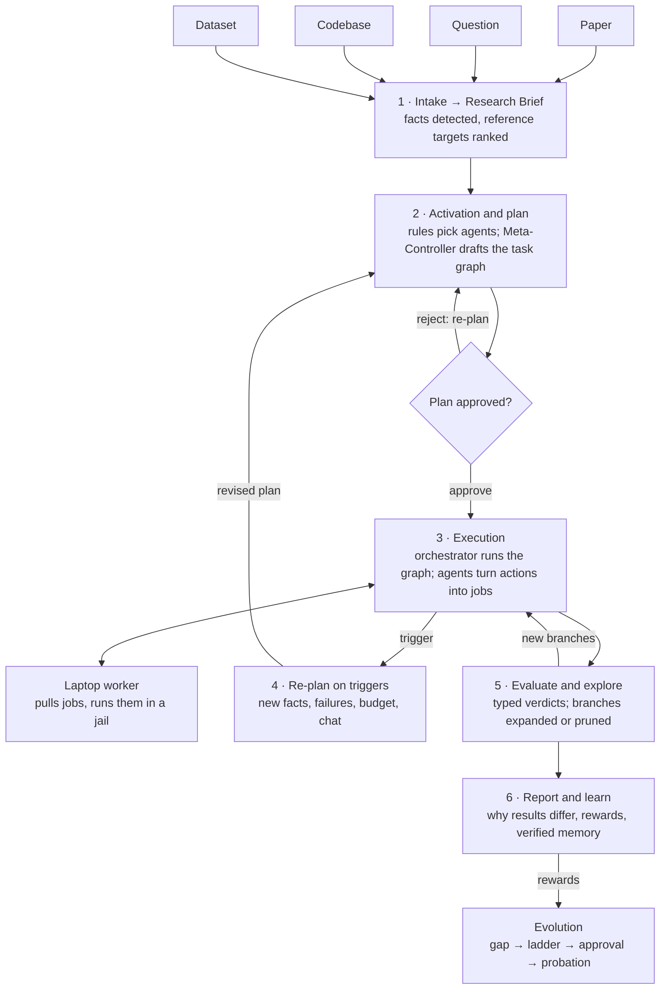
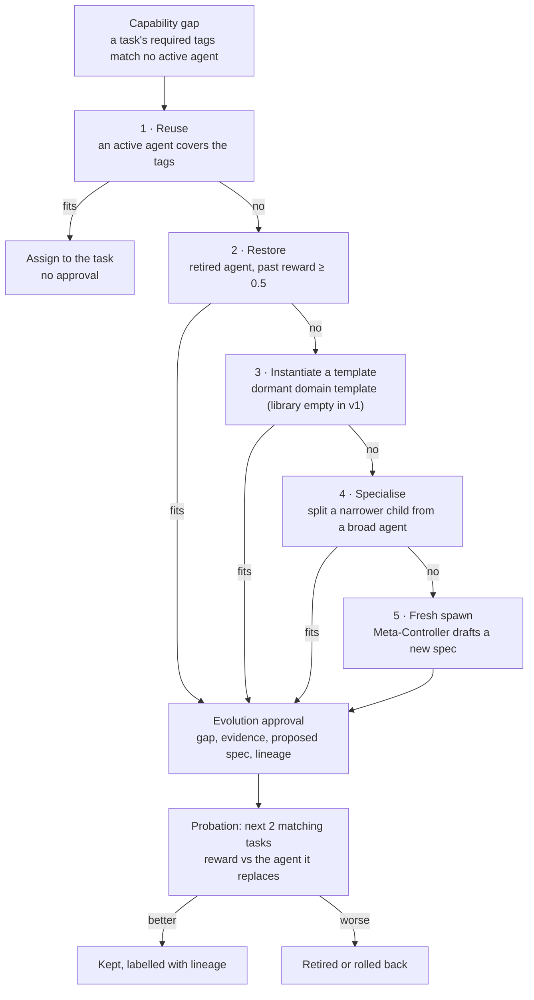

# WORKFLOW

Version 0.3, 2026-10-10. The end-to-end workflow, step by step, with an owner for every step. Companion to [PRD.md](PRD.md), [ARCHITECTURE.md](ARCHITECTURE.md), [API.md](API.md) and [AGENTS.md](AGENTS.md). A live copy with rendered diagrams is kept as the shared doc "EvoLab Workflow".

EvoLab turns any mix of a paper, question, codebase or dataset into an approved plan, runs it on the researcher's own laptop, and returns a report that explains its results. The Meta-Controller decides which agents work, re-plans when new facts arrive, and grows the team when a capability is missing.

## At a glance



A run flows down six stages. Three loops send it back: a rejected plan, a re-planning trigger during execution, and new what-if branches after evaluation. Rewards feed the evolution engine that grows the team.

## How to read this document

Every step names two owners: who does it **while a run is live** (an agent, a service, the worker or the researcher) and who **builds** it during the hackathon (developer A, B or C).

| Owner | Who | Examples |
|---|---|---|
| LLM agent | One of the 9 agents, run by the generic agent loop in the backend | Meta-Controller, Paper Analyst, Debugger |
| Service | Plain code in the backend, no LLM | Executor, Ledger, Librarian, Intake classifier, Orchestrator |
| Worker | `worker.py` on the researcher's laptop; runs jobs only | Clone, pip install, train, profile a dataset |
| Researcher | The human, on desktop or phone | Approvals, chat, feedback, branch controls |
| Dev A | Backend, agents, deploy | Orchestrator, agent runtime, activation rules, evolution engine |
| Dev B | Worker, experiments, n8n | Worker policy, experiment scripts, dataset profiling, repo smoke-test harness |
| Dev C | Frontend, mocks, demo | Intake UI, candidate picker, activation view, run page |

Three rules hold at every stage:

- **Agents think in the backend; workers act on the laptop.** No agent ever runs a command directly; it creates a job.
- **The Meta-Controller decides who works.** Agents report findings through `signals[]` and may suggest a next step; they never choose the next agent.
- **Every decision is an event with a reason.** The dashboard is a view over the `events` table, so anything described here is visible to the researcher.

## Stage 0: Setup

Before any run can execute, one worker must be online. Planning can start without it, but no job runs until it connects.

| # | Step | Runtime owner | Build owner |
|---|---|---|---|
| 0.1 | Researcher opens the dashboard and signs in | Researcher | C (UI), A (auth) |
| 0.2 | Dashboard requests a pairing code (`POST /workers/pairing`); a ready-made one-line command is shown | Backend API | A |
| 0.3 | Researcher runs `python worker.py` with the code on their laptop | Researcher | B |
| 0.4 | Worker registers, receives a revocable token, reports CPU, RAM and Python version | Worker → Backend | B (worker), A (route) |
| 0.5 | Worker heartbeats every 10 s; offline after 30 s of silence | Worker, Orchestrator | B, A |
| 0.6 | Researcher sets (or accepts) the run budget: wall time, tokens, concurrent jobs and agents | Researcher | C |

The worker only polls outward, so it works behind college Wi-Fi with no open ports. Its local policy (workspace jail, command allowlist, timeouts) is enforced on the laptop **and** again on the backend when a job is created.

## Stage 1: Intake

Intake accepts **any combination** of inputs (at least one) and turns them into a single **Research Brief** that every later step works from.

| Input kind | How it arrives | Notes |
|---|---|---|
| Paper | arXiv or web URL, or PDF upload | Text extracted on the backend; treated as untrusted data |
| Question | Free text (the goal box, or a dedicated question field) | Can stand alone or frame other inputs |
| Codebase | Git repository URL | Recorded only; never cloned or run at intake |
| Dataset | URL, browser upload, or a path on the worker's machine | No size cap for now (Q-18) |
| Note | Free text | Context only; activates no agent |

| # | Step | Runtime owner | Build owner |
|---|---|---|---|
| 1.1 | Researcher fills the four-mode intake screen (or clicks the example) | Researcher | C |
| 1.2 | API validates and stores each input as untrusted data; URLs are queued, never fetched in the request | Backend API | A |
| 1.3 | **Facts detection**: classify each input and look for links between them (README cites the paper? paper names the dataset? question names the paper?) | Intake classifier (service) | A |
| 1.4 | Ambiguous cases only go to the Meta-Controller's fast model for a one-line judgement | Meta-Controller | A |
| 1.5 | Write the Research Brief to `runs.brief_json`; emit `intake.brief` | Intake classifier | A |
| 1.6 | Dashboard shows the Brief: inputs found, links detected, reference targets | Frontend | C |

```json
{
  "entry_types": ["paper", "repo", "dataset", "question"],
  "goal": "Do KANs beat MLPs on real tabular data?",
  "inputs": ["inp_paper", "inp_repo", "inp_data", "inp_q"],
  "facts": [
    { "fact": "repo_links_paper", "evidence": "README cites arXiv 2404.19756" },
    { "fact": "dataset_not_in_paper", "evidence": "dataset name absent from paper text" },
    { "fact": "question_about_paper", "evidence": "question names KAN and MLP" }
  ],
  "reference_targets": [
    { "type": "paper_claim", "source": "inp_paper", "rank": 1 },
    { "type": "repo_reported", "source": "inp_repo", "rank": 2 }
  ]
}
```

**Reference targets** are what results are compared against. A run can hold several; the main verdict uses the highest-ranked one: paper claim > numbers reported in the repository > published baselines > internal baselines (exploratory). The target's type is shown everywhere, so a dataset-only run is never presented as a reproduction.

## Stage 2: Activation and planning

Deterministic rules turn the Brief's facts into required capabilities; the Meta-Controller adapts that list into a task graph; the researcher approves it before any expensive work starts.

### 2a. Activation rules (deterministic)

| Fact in the Brief | Capability activated | Agent |
|---|---|---|
| Paper present | Extract claim, metric, datasets, hyperparameters, missing details | Paper Analyst |
| Codebase present | Audit, smoke test, recommend Mode A, B or C | Repo Auditor |
| Dataset present | Profile data (size, columns, target, missing values, leakage flags) | Env and Data Engineer |
| Question present, no paper | Find 3–5 candidate papers **and** open the mandatory exploratory branch | Paper Analyst (Scout tools) + Experiment Designer |
| Paper + its own codebase | Check paper–code consistency; choose mode | Repo Auditor |
| Paper + a codebase it does not link | Ask the researcher whether the codebase belongs to this study | Meta-Controller (`human_input` approval) |
| Paper + the paper's own dataset | Reproduce on the researcher's copy | Implementer |
| Paper + a different dataset | Add a **transfer what-if** (the paper's method on the new data) | Experiment Designer |
| Codebase + dataset | Adapt the codebase to the new data | Implementer |
| Question + paper or codebase | Question becomes the hypothesis that frames the what-if branches; no candidate search | Experiment Designer |
| Note | Context only | — |
| Every run | Always on | Meta-Controller, Executor, Evaluator, Ledger, Librarian, Reporter; Debugger on demand |

Agents not activated stay visible on the team view, greyed out with the reason ("not required: no codebase supplied").

### 2b. The Meta-Controller's plan

The Meta-Controller receives the Brief, the activation list, the budget, relevant memory and the agent registry. It returns:

- `activation[]`: the final agent list, each addition or removal with a written reason
- `task_graph`: tasks, owners and dependencies, built from per-input **fragments** (one sub-graph per entry type) joined by the activation rules
- `mode`: A, B or C, once the Repo Auditor has reported (re-planned in if the audit arrives later)
- `reference_targets`: confirmed or corrected
- `estimates`: wall time and tokens

If a required capability has no matching agent, the plan carries a **capability gap** and the spawning flow starts (see "Dynamic spawning and evolution").

### 2c. Steps

| # | Step | Runtime owner | Build owner |
|---|---|---|---|
| 2.1 | Apply activation rules to the Brief; store `runs.activation_json`; emit `agent.activation` | Activation service | A |
| 2.2 | Retrieve up to 3 relevant memory entries (past audits, gotchas, config outcomes) | Librarian | A (B may take over retrieval) |
| 2.3 | Draft activation, task graph, mode, targets and estimates | Meta-Controller | A |
| 2.4 | Create a `plan` approval showing the graph, the active agents and the cost estimate | Approvals service | A (backend), C (approval card) |
| 2.5 | Researcher approves, edits or rejects (desktop, phone or n8n) | Researcher | C, B (n8n) |
| 2.6 | On reject: re-plan with the researcher's comment; on approve: run moves to `running` | Orchestrator | A |

## Stage 3: Execution

The orchestrator walks the approved task graph in plain code: when a task finishes, every task it unblocks starts, with no LLM call in between.

### How one agent task runs

1. Orchestrator picks an unblocked task and loads the agent's current version (prompt, tools, model).
2. Librarian injects up to 3 memory entries, each labelled `seeded` or `learned`.
3. The agent loop calls the LLM; each tool call either runs inline in the backend (memory, ledger, notes, search) or becomes a **job** for the worker.
4. A job-creating task is **suspended** (`waiting_for_job`); no LLM call is held open while code trains.
5. Worker claims the job, runs it inside the jail, streams logs, returns exit code, metrics and files.
6. Orchestrator appends the result to the task's history and resumes the loop.
7. Agent calls `finish(output)`; output is validated against its JSON schema, including `signals[]` and optional `suggested_next`.
8. Every change that departs from the paper or the official code is written to the Ledger **at that moment**, with a category.

### Typical task chain (paper + codebase)

| # | Task | Runtime owner | Build owner |
|---|---|---|---|
| 3.1 | Extract the reproduction spec | Paper Analyst | A |
| 3.2 | Clone repo, smoke test, audit, recommend mode | Repo Auditor + worker jobs | A (agent), B (smoke-test harness) |
| 3.3 | Create venv, pin dependencies, fetch and profile data | Env and Data Engineer + worker jobs | A (agent), B (profiling script) |
| 3.4 | Patch code (Mode A) or build the clean-room core (Mode C) | Implementer | A |
| 3.5 | Scale epochs, seeds and subsets to the budget; queue experiments | Executor (service) | A |
| 3.6 | Run baseline experiments | Worker | B (worker, experiment scripts) |
| 3.7 | On failure: diagnose, consult memory, patch, re-run | Debugger | A |

### Failure handling

- A failed job wakes the Debugger with logs, history and memory hits.
- Fixed and re-run successfully → a **verified** `error_fix` lesson is written to memory.
- The agent whose output caused the failure is recorded as `failure_origin_agent_id` and loses outcome score.
- Two failures in the same error class, not fixed → escalate to the Meta-Controller (a re-planning trigger, and a spawn candidate).

### Researcher control during execution

Pause, resume or cancel the run; pause or kill a branch; chat to the Meta-Controller ("try noisy data"); approve risky commands, new packages and long runs as they come up.

## Stage 4: Re-planning (hybrid model)

The Meta-Controller is called again only when something happens, roughly 5 to 15 times per run, never after every task.

| Trigger | Example | Likely re-plan |
|---|---|---|
| New fact in a task's `signals[]` | Repo Auditor finds the README links a paper | Activate the Paper Analyst; add the paper claim as a target |
| Data issue | Profile finds leakage or no target column | Insert a data-fix task, or ask the researcher |
| Unresolved failure | Same error class failed twice | Re-route, or raise a spawn candidate |
| Branch results | A what-if shows a large effect | Expand or prune; ask the Designer for follow-ups |
| Researcher action | Chat message, rejected approval, new input added mid-run | Revise the graph |
| Budget threshold | 70% of time or tokens used | Prune remaining branches; start the Reporter early |
| Capability gap | No agent's tags match a needed task | Spawning flow |

| Kind | Examples | What happens |
|---|---|---|
| Minor | Add a debug or data-fix task; reorder pending tasks; drop a crashed branch | Applied at once; logged as `plan.revised` with the diff and reason |
| Major | New agent activated; new reference target; budget increase; mode change | A `plan` approval showing the diff; work on unaffected tasks continues |

| # | Step | Runtime owner | Build owner |
|---|---|---|---|
| 4.1 | Watch task outputs and events for trigger conditions | Orchestrator (deterministic) | A |
| 4.2 | Call the Meta-Controller in `replan` mode with the current graph and the trigger | Meta-Controller | A |
| 4.3 | Classify the returned diff as minor or major; apply or request approval | Orchestrator, Approvals | A |
| 4.4 | Show the plan timeline: every revision, its trigger and reason | Frontend | C |

## Stage 5: Evaluation and exploration

The Evaluator scores results against each reference target; the Designer proposes what-if branches; the Meta-Controller decides which branches to expand or prune, always with a recorded reason.

| Verdict | When it is used |
|---|---|
| `reproduced` | Matches the paper claim (or repo numbers) within seed variance |
| `partial` | Matches on some tasks or trends, not others |
| `not_reproduced` | Contradicts the claim beyond seed variance |
| `baseline_established` | Dataset path with no published claim: baselines measured |
| `exploratory` | Question path with no paper: findings with stated confidence |

Statistics (means, seed variance, deltas) are computed in code and passed to the Evaluator; the LLM writes the judgement, not the numbers. The Evaluator is a core agent and is never evolved, so it never grades itself.

| # | Step | Runtime owner | Build owner |
|---|---|---|---|
| 5.1 | Compute statistics across seeds for every experiment | Evaluator stats (code) | A |
| 5.2 | Verdict per reference target; outcome scores per agent; failure origins | Evaluator | A |
| 5.3 | Propose what-if branches with hypothesis, cost and expected effect | Experiment Designer | A (agent), B (experiment scripts) |
| 5.4 | Branches run in parallel within the budget | Executor, worker | A, B |
| 5.5 | Expand or prune each branch with `decision_reason` and evidence | Meta-Controller | A |
| 5.6 | Show the exploration tree with status, metrics and reasons | Frontend | C |

Decision rights stay fixed: the Designer **proposes**, the Evaluator **scores**, the Meta-Controller **decides** and spends the budget.

## Stage 6: Report and learning

The run ends with a report the researcher can keep, rewards for every agent task, verified lessons in memory, and any evolution proposals waiting for approval.

- **Report:** results tables and plots; a verdict per reference target, labelled with its type; "why results differ", built from the Ledger; for exploratory runs, findings, confidence and suggested next experiments; links to commits, logs and ledger entries.
- **Rewards:** `R = 0.6 × O + 0.2 × (1 − C) + 0.2 × F`. Paper Analyst on the question path is scored on whether the researcher picked one of its candidates; the Repo Auditor on the codebase path is also scored on whether its inferred claim was confirmed.
- **Memory:** only verified lessons are written; duplicates increment counters. New kind `dataset_profile` lets a later dataset run skip re-profiling.

| # | Step | Runtime owner | Build owner |
|---|---|---|---|
| 6.1 | Write the report and "why results differ" section | Reporter | A (agent), C (report view) |
| 6.2 | Compute and store reward per agent task; update rolling averages | Evolution engine (code) | A |
| 6.3 | Write verified lessons; record which retrieved entries helped | Librarian | A (B may take over) |
| 6.4 | Check evolution triggers; draft proposals; create `evolution` approvals | Evolution engine, Meta-Controller | A |
| 6.5 | Notify the researcher (`run_finished`) by dashboard and phone | Backend, n8n | A, B |

## Dynamic spawning and evolution

When a task needs a capability no active agent covers, the Meta-Controller fills the gap by the cheapest route that works (reuse, restore, instantiate a template, specialise an existing agent, or spawn a new one), and every new agent goes through an approval and a probation window.



### Capability tags

Every agent version carries `capability_tags` (for example `paper:extract`, `repo:audit`, `data:profile:tabular`, `debug:python`, `lib:pykan`, `domain:materials`). Every task carries `required_tags`. An agent matches a task when its tags cover all required tags; ties are broken by rolling reward. Intake adds a `domain:*` tag to the Brief (`materials`, `edge-ml`, `cpu-ml`, `3d` or `general`). The seed tag set is in AGENTS.md section 1a.

### Where gaps come from

| Source | Detected by | Example |
|---|---|---|
| Planning-time gap | Activation service, when building the graph | Dataset path needs `bench:tabular-protocol`; no active agent has it |
| Runtime gap | Evolution engine (deterministic rule) | Same error class escalated or failed twice, and no agent's tags or tools match it |
| Researcher request | Chat | "Add someone who checks unit consistency" |

### The resolution ladder (cheapest first)

1. **Reuse**: an active agent covers the tags → assign it. No approval.
2. **Restore**: an inactive or retired agent covers the tags and had rolling reward ≥ 0.5 → propose restoring it.
3. **Instantiate a template**: a dormant domain template covers the tags → propose a copy as a new agent (`kind: spawned`, `origin: template:<name>`), prompt seeded with up to 3 memory entries.
4. **Specialise**: an existing agent covers the area broadly (the Debugger for `pykan` errors) → propose a narrower child with a focused prompt and the lessons that caused the split; the parent keeps general work.
5. **Fresh spawn**: nothing fits → the Meta-Controller drafts a new spec: name, tags, prompt (seeded with memory and the failing examples), tools and model tier.

Steps 2–5 each create an `evolution` approval carrying the gap, the evidence, the proposed spec and the expected effect. Nothing applies without a decision.

### Probation and lifecycle

- **Probation:** a new or refined agent handles the next 2 matching tasks. If its mean reward is below the agent that did that work before, it is retired (specialist) or rolled back (refinement), and the event is logged.
- **Refine:** rolling reward below 0.6 with the same failure twice → new prompt version; the diff is shown in the approval.
- **Merge:** two agents invoked together in ≥ 80% of tasks, overlapping tools, similar scores → one merged spec; both originals retired.
- **Retire:** rolling reward below 0.35 over ≥ 5 tasks, or a specialist underperforming its parent → soft retire, restorable.

### Guardrails

- Tools come only from the existing registry; no agent creates a new tool at runtime.
- Core agents (Meta-Controller, Executor, Evaluator, Ledger, Librarian) are never retired or rewritten.
- Spawned agents cannot spawn; only the Meta-Controller proposes.
- At most 15 active agents; one evolution action per agent per run.
- The untrusted-content rule is appended to every prompt by code and cannot be removed by a refinement.
- Every spawned agent shows its lineage (template, parent or fresh) on the team view.

### Domain-specific templates (out of v1 build scope)

The 22 domain agents are **not built or tested in v1**. The registry supports them as `kind: template`, `status: dormant`, so ladder step 3 works the day they are added (Q-20). Each would be a spec stub only: name, tags, a one-paragraph prompt, and tools from the generic registry.

| Domain (`domain:*`) | Templates | Would be instantiated when |
|---|---|---|
| Materials science (`materials`) | Materials Data Agent, Crystal Graph Builder, Benchmark Protocol Agent, Composition Featurizer, Pretrained Potential Agent, Physical Units Validator | Brief tagged `materials`, or CIF or Matbench data detected |
| Edge and efficient ML (`edge-ml`) | Distillation Specialist, Efficiency Profiler, Quantization Agent, Pruning Agent, Compact Architecture Agent | Brief tagged `edge-ml`, or a size, latency or sparsity what-if |
| Machine learning on a CPU (`cpu-ml`) | Tabular Benchmark Agent, Classical Baselines Agent, Long-Run Dynamics Monitor, KAN / Symbolic Agent, Physics-Loss Agent, Sparse Compute Agent | Tabular dataset path, KAN or PINN papers, long training-dynamics runs |
| 3D (`3d`) | Point Cloud Data Agent, Visual Evaluator, Geometry Ops Agent, Neural Rendering Agent, Voxel Grid Agent | Point clouds, meshes or multi-view images detected |

Two consequences for the demo:

- With an empty template library, the tabular part of the combined demo produces a **fresh spawn**: real evolution, not a template copy.
- Even if the `cpu-ml` stubs are added, the `pykan` API-drift gap (tags `lib:pykan`, `debug:python`) does not match the KAN / Symbolic template, so the "KAN API Specialist" remains a genuine specialise event.

| # | Step | Runtime owner | Build owner |
|---|---|---|---|
| E.1 | Tag agents and tasks; match tags to tasks | Activation service | A |
| E.2 | Detect planning-time and runtime gaps | Activation service, Evolution engine | A |
| E.3 | Walk the ladder; draft the proposal | Meta-Controller | A |
| E.4 | Show the approval card with gap, evidence, proposed spec and lineage | Frontend | C |
| E.5 | Apply: new `agents` and `agent_versions` rows; emit `agent.evolution` | Evolution engine | A |
| E.6 | Probation and rollback | Evolution engine | A |
| E.7 | Provide a reproducible failure (pinned `pykan` drift) to test that triggers fire naturally | — | B |

## Path by path

All four paths are built to full depth, in this order: paper, codebase, dataset, question (D-028). Each path is a graph **fragment**; combined inputs join fragments through the activation rules.

| Path | Fragment (in order) | Reference target | Verdict types | Build order |
|---|---|---|---|---|
| **Paper** | Paper Analyst → (Repo Auditor if a codebase is found) → Env and Data → Implementer → Executor → Evaluator → Designer → Reporter | Paper claim | reproduced, partial, not_reproduced | 1st |
| **Codebase** | Repo Auditor (clone, smoke test, read README, infer the claim, find a linked paper) → Paper Analyst if a paper is linked → Env and Data → Implementer → Executor → Evaluator → Designer → Reporter | Linked paper's claim, else repo-reported numbers, else "runs and characterised" | as paper, or baseline_established | 2nd |
| **Dataset** | Env and Data (fetch, profile, leakage check) → Paper Analyst searches published baselines → Designer builds a baseline suite → Executor → Evaluator → Designer (what-ifs) → Reporter | Published baselines, else internal baselines | baseline_established | 3rd |
| **Question** | Paper Analyst finds 3–5 candidate papers **and** Designer opens the exploratory branch, in parallel → `candidate_selection` approval → chosen paper joins as the paper fragment; exploratory branch continues alongside | Chosen paper's claim; exploratory branch uses internal baselines | as paper, plus exploratory | 4th |

### Exploratory mode (mandatory on the question path)

1. Designer turns the question into 2–4 testable hypotheses, each with a measurable outcome.
2. Env and Data finds or generates suitable data (public dataset, or a synthetic one when the question is about a function class).
3. Executor runs small, budget-scaled experiments for each hypothesis.
4. Evaluator reports effect sizes and seed variance; verdict `exploratory` with stated confidence.
5. Reporter writes findings and the next experiments worth running.

The exploratory branch keeps running after the researcher picks a candidate paper, so the report answers the question directly as well as through the paper.

| Path | A (backend, agents) | B (worker, experiments) | C (frontend) |
|---|---|---|---|
| Paper | Fragment, Paper Analyst, spec schema | KAN experiment scripts, cached baseline | Intake paper mode, run page |
| Codebase | Fragment, Repo Auditor claim inference | Repo smoke-test harness | Intake codebase mode, audit view |
| Dataset | Fragment, baseline-suite planning | Dataset profiling script, baseline scripts | Intake dataset mode (URL, upload, worker path) |
| Question | Fragment, candidate search, exploratory planning | Exploratory experiment scripts | Intake question mode, candidate picker |

## The combined-input demo run

One run with four inputs shows dynamic activation, re-planning, a specialise event, a spawn and memory reuse in a single story (D-035).

**Inputs:** the KAN paper (Liu et al., 2024, arXiv 2404.19756), the official `pykan` repository, one small real tabular dataset (Q-19, owner B), and the question *"Do KANs beat parameter-matched MLPs on real tabular data?"*

| Beat | What the audience sees | Behind it | Build owner |
|---|---|---|---|
| 1 | Four inputs entered on the intake screen | Four-mode intake | C |
| 2 | Brief: "repo links paper", "dataset not in paper", "question about paper" | Facts detection | A |
| 3 | Team view: all agents active; candidate search greyed, "not required: paper supplied" | Activation rules | A, C |
| 4 | Plan approved from a phone | Plan approval, n8n | A, B, C |
| 5 | Repo audit picks Mode A; baseline KAN vs MLP runs stream live | Repo Auditor, worker | A, B |
| 6 | `pykan` API drift: the Debugger fails twice; approval card proposes a **KAN API Specialist** (specialise, ladder step 4) | Runtime gap, evolution engine | A, B (reproducible drift) |
| 7 | Data profile flags an issue (for example a leaky ID column) → minor re-plan adds a data-fix task, shown on the plan timeline | `signals[]`, re-planning | A, C |
| 8 | Tabular benchmarking needs `bench:tabular-protocol`; no agent or template has it → **fresh spawn** proposed with evidence | Planning-time gap | A |
| 9 | Exploration tree: noise, grid size, tuned-MLP fairness check, tabular transfer; one expanded, one pruned, each with a reason | Designer, Evaluator, Meta-Controller | A, B, C |
| 10 | Report: paper claim `partial` (expected), tabular transfer `baseline_established`, "why results differ" citing ≥ 3 ledger entries | Reporter, Ledger | A, C |
| 11 | Short second run on another tabular dataset: learned `error_fix` and `dataset_profile` entries reused; fewer failed attempts | Librarian | A, B |

**Honesty rules:** cached baselines, pre-extracted specs and replayed event streams are labelled as such in the UI and when presenting. Evolution events are not hard-coded; B pre-tests that the drift reproduces and the triggers fire naturally, and a recorded run is the fallback. If the KAN result does not match the paper, the report says so and explains why.

## Responsibility matrix

| Developer | Owns in this workflow |
|---|---|
| **A: Backend, agents, deploy** | Intake API and facts detection; Research Brief; activation rules and fragments; Meta-Controller plan and `replan` mode; orchestrator; agent runtime and schemas (`signals[]`, `suggested_next`); typed Evaluator verdicts; capability tags, gap detection and the resolution ladder; evolution engine and probation; Librarian and Ledger (until B takes them); Voroa deploy and UseShipReady fixes |
| **B: Worker, experiments, n8n** | Worker, jail and policy; KAN experiment scripts and cached baseline; dataset profiling script; repo-only smoke-test harness; exploratory and baseline-suite scripts; reproducible `pykan` drift for the demo; demo tabular datasets; n8n phone approvals |
| **C: Frontend, mocks, demo** | Four-mode intake screen (including upload and worker-path datasets); Brief view; candidate picker approval card; activation view (greyed agents with reasons); plan timeline; evolution approval card with lineage; exploration tree; report view; mocks for each entry type; demo script and labelled replay fallback |

Decisions D-028 to D-037 and open questions Q-18 to Q-22 that this workflow depends on are recorded in [logs/DECISIONS.md](logs/DECISIONS.md) and [logs/OPEN_QUESTIONS.md](logs/OPEN_QUESTIONS.md).
